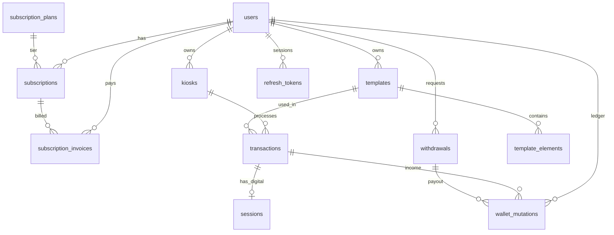

# PRD-01: Backend API — memoir. Platform

> **Versi:** 1.0
> **Tanggal:** 5 Maret 2026
> **Status:** Draft — For Review
> **Audiens:** Internal dev team & AI coding agents
> **Parent:** [PRD-00-master.md](./PRD-00-master.md) (Platform Overview)

---

## 1. Executive Summary

### 1.1 Problem Statement

Platform memoir. membutuhkan backend terpusat yang melayani 4 client surface (Owner Dashboard Web, Super Admin Dashboard Web, Desktop Kiosk Runner, Mobile Kiosk Runner) dengan kebutuhan yang berbeda: multi-tenant data isolation (per owner), operasi finansial atomik (wallet + withdrawal), integrasi payment gateway, dan autentikasi yang meng-cover web user (JWT + refresh token) maupun kiosk device (permanent device_token).

### 1.2 Proposed Solution

Backend API berbasis **Node.js + Fastify 5.x** dengan arsitektur **Clean Architecture 4-layer** yang memisahkan business logic dari framework. Menggunakan **Drizzle ORM** untuk type-safe database access ke **Supabase PostgreSQL**, dan **Zod** untuk request/response validation. Dokumentasi API disusun dalam file markdown terpisah sebagai referensi untuk semua client.

### 1.3 Success Criteria

| # | KPI | Target | Cara Ukur |
|---|-----|--------|-----------|
| 1 | **API response time** | p99 < 300ms (endpoint non-upload) | APM / load test |
| 2 | **Kiosk endpoint latency** | < 500ms per endpoint | Monitoring |
| 3 | **Zero wallet drift** | 0 duplikat `wallet_mutation` per transaksi | Idempotency integration test |
| 4 | **Price validation accuracy** | 100% setiap PriceMismatch terdeteksi | Unit test + integration test |
| 5 | **Auth security** | 0 data leakage lintas tenant | Authorization middleware test |
| 6 | **Uptime** | ≥ 99.5% monthly | Uptime monitoring |

---

## 2. User Experience & Functionality

### 2.1 User Personas (Backend Perspective)

| Persona | Auth Mechanism | Endpoint Group | Scope |
|---------|---------------|----------------|-------|
| **P1 — Platform Admin** | JWT (access + refresh token) | `/admin/*` | Semua data platform |
| **P2 — Studio Owner** | JWT (access + refresh token) | `/owner/*` | Hanya data milik owner |
| **P3 — Kiosk Runner** | `device_token` (JWT long-lived) | `/kiosk/*` | Hanya data owner yang ter-pair |
| **P4 — Customer** | Tidak ada (indirect via kiosk) | — | Tidak mengakses API langsung |

### 2.2 Epic & Feature Index

| Epic | Feature | ID | Priority |
|------|---------|------|----------|
| **EPIC-01: Auth & Pairing** | User Login (email + password) | FEAT-01.1 | P0 |
| | Refresh Token | FEAT-01.1b | P0 |
| | Logout (Revoke Token) | FEAT-01.1c | P0 |
| | Kiosk Device Pairing (6-digit code) | FEAT-01.2 | P0 |
| **EPIC-02: Kiosk Runtime** | Kiosk Config & Subscription Status | FEAT-02.1 | P0 |
| | Template Sync | FEAT-02.2 | P0 |
| | Create Transaction | FEAT-02.3 | P0 |
| | Confirm Cash / QRIS Payment | FEAT-02.4 | P0 |
| | Check Payment Gateway Status | FEAT-02.5 | P0 |
| | Upload Digital Copy Session | FEAT-02.6 | P0 |
| **EPIC-03: Owner Management** | Kiosk CRUD & Pairing Code Gen | FEAT-03.1 | P0 |
| | Template CRUD | FEAT-03.2 | P0 |
| | Template Element CRUD | FEAT-03.3 | P0 |
| | Asset Upload | FEAT-03.4 | P0 |
| **EPIC-04: Owner Finance** | Wallet Balance & Mutation History | FEAT-04.1 | P0 |
| | Withdrawal Request | FEAT-04.2 | P0 |
| | Transaction History | FEAT-04.3 | P0 |
| **EPIC-05: Owner Subscription** | Select / Upgrade Plan | FEAT-05.1 | P0 |
| | Invoice & Payment Check | FEAT-05.2 | P0 |
| **EPIC-06: Admin Platform** | Owner Account CRUD | FEAT-06.1 | P0 |
| | Subscription Plan CRUD | FEAT-06.2 | P0 |
| | Platform Config Management | FEAT-06.3 | P0 |
| | Withdrawal Approve / Reject | FEAT-06.4 | P0 |
| | Cross-owner Transaction Monitoring | FEAT-06.5 | P0 |

### 2.3 Non-Goals (Apa yang TIDAK dibangun)

| # | Non-Goal | Alasan |
|---|----------|--------|
| NG-01 | Webhook receiver dari Payment Gateway | MVP: polling-based via button |
| NG-02 | WebSocket / push notification | MVP: request-response only |
| NG-03 | Email notification | Manual komunikasi via WhatsApp/email di luar sistem |
| NG-04 | Self-registration owner | Admin-only create untuk kontrol kualitas |
| NG-05 | OAuth / SSO | MVP: email+password only |
| NG-06 | Auto-renewal subscription | MVP: manual renewal via check-payment |
| NG-07 | Prorate billing saat upgrade/downgrade plan | MVP: full price setiap subscribe |
| NG-08 | Image processing / compression server-side | Composite dilakukan di client (Electron/Flutter) |
| NG-09 | Scheduled jobs / cron | Semua status check dilakukan lazy/on-demand |
| NG-10 | Refund / chargeback otomatis | Manual di luar sistem |
| NG-11 | Aggregate analytics endpoints | MVP: raw data only |

---

## 3. Technical Specifications

### 3.1 Architecture Overview — Clean Architecture 4-Layer

```
┌─────────────────────────────────────────────────────────────────┐
│                      Presentation Layer                         │
│  Routes (Fastify plugins) → Zod Schemas → Controllers           │
│  Auth hooks (verifyJwt / verifyDeviceToken)                     │
│  Error handler plugin                                           │
└───────────────────────────┬─────────────────────────────────────┘
                            │ calls
┌───────────────────────────▼─────────────────────────────────────┐
│                      Application Layer                          │
│  Use Cases (business orchestration)                             │
│  Depend on ports (interfaces) — NOT implementations             │
└───────────────────────────┬─────────────────────────────────────┘
                            │ depends on
┌───────────────────────────▼─────────────────────────────────────┐
│                        Domain Layer                             │
│  Entities (12) + Domain Services (PriceCalculator,              │
│  SubscriptionChecker) + Domain Errors (AppError hierarchy)      │
│  PURE — no framework dependency                                 │
└───────────────────────────┬─────────────────────────────────────┘
                            │ implemented by
┌───────────────────────────▼─────────────────────────────────────┐
│                    Infrastructure Layer                         │
│  Repositories (Drizzle ORM) + StorageService (Supabase)         │
│  PaymentGateway (Xendit) + HashService (argon2) + TokenService  │
│  (jose) + UnitOfWork (Drizzle transaction)                      │
└─────────────────────────────────────────────────────────────────┘
```

**Dependency Rule:** Inner layers tidak boleh depend pada outer layers. Use cases depend pada interfaces (ports), bukan pada concrete implementations.

### 3.2 Tech Stack

| Layer | Technology | Versi | Catatan |
|-------|-----------|-------|---------|
| Runtime | Node.js | 22 LTS | — |
| Framework | **Fastify** | 5.x | Low overhead, plugin architecture, encapsulated contexts |
| Language | TypeScript | 5.x | Strict mode |
| ORM | **Drizzle ORM** | Latest | Type-safe, lightweight, zero overhead |
| Validation | **Zod** | 3.x | Request/response validation |
| Type Provider | `fastify-type-provider-zod` | — | Zod ↔ Fastify schema integration |
| API Docs | Markdown file terpisah | — | Tidak menggunakan OpenAPI/Swagger untuk sementara |
| Database | PostgreSQL | 15+ | Via Supabase managed |
| Auth — JWT | `jose` | — | HS256, stateless access token |
| Auth — Refresh Token | Custom (hashed, DB-stored) | — | Random 64-char hex, SHA-256 hashed |
| Auth — Password | `argon2` | — | Constant-time verification |
| Storage | `@supabase/supabase-js` | — | Service role key (server-only) |
| Payment Gateway | Xendit SDK / REST | — | Via `IPaymentGateway` port |
| Cookie | `@fastify/cookie` | — | HttpOnly cookie untuk refresh token |
| Rate Limiting | `@fastify/rate-limit` | — | Auth + pairing endpoints |
| CORS | `@fastify/cors` | — | Whitelist origins, `credentials: true` |
| Security Headers | `@fastify/helmet` | — | Default security headers |
| Multipart | `@fastify/multipart` | — | File upload (asset, session) |
| Linting | Biome | — | Lint + format |
| Testing | Vitest + Supertest | — | Unit + integration |
| Package Manager | pnpm | — | Konsisten lintas repo |

### 3.3 Project Structure

```
memoir-api/
├── src/
│   ├── domain/                          # Pure business logic
│   │   ├── entities/                    # 13 entity interfaces
│   │   │   ├── user.entity.ts
│   │   │   ├── kiosk.entity.ts
│   │   │   ├── template.entity.ts
│   │   │   ├── template-element.entity.ts
│   │   │   ├── transaction.entity.ts
│   │   │   ├── session.entity.ts
│   │   │   ├── subscription-plan.entity.ts
│   │   │   ├── subscription.entity.ts
│   │   │   ├── subscription-invoice.entity.ts
│   │   │   ├── wallet-mutation.entity.ts
│   │   │   ├── withdrawal.entity.ts
│   │   │   ├── platform-config.entity.ts
│   │   │   └── refresh-token.entity.ts
│   │   ├── services/                    # Pure domain logic
│   │   │   ├── price-calculator.ts      # Resolve harga + kalkulasi total
│   │   │   └── subscription-checker.ts  # Lazy status computation
│   │   └── errors/                      # Error hierarchy
│   │       └── app-error.ts             # AppError + semua subclass
│   │
│   ├── application/                     # Orchestration
│   │   ├── ports/                       # Interface definitions
│   │   │   ├── repositories/            # IUserRepo, IKioskRepo, dll.
│   │   │   ├── services/               # IHashService, ITokenService, IPaymentGateway, IStorageService
│   │   │   └── unit-of-work.ts         # IUnitOfWork
│   │   └── use-cases/
│   │       ├── auth/                    # LoginUseCase, PairKioskUseCase, RefreshTokenUseCase, LogoutUseCase
│   │       ├── kiosk/                   # GetKioskConfig, SyncTemplates, CreateTransaction, ConfirmCash, CheckPg, UploadSession
│   │       ├── owner/                   # ManageKiosk, ManageTemplate, ManageElements, GetTransactions, GetWallet, RequestWithdrawal, ManageSubscription, etc.
│   │       └── admin/                   # ManageOwners, ManagePlans, ManageConfig, ApproveWithdrawal, RejectWithdrawal, ListAllTransactions
│   │
│   ├── infrastructure/                  # Concrete implementations
│   │   ├── database/
│   │   │   ├── schema/                  # Drizzle schema definitions (12 tables)
│   │   │   ├── repositories/            # Drizzle repository implementations
│   │   │   └── unit-of-work.ts          # Drizzle transaction wrapper
│   │   ├── services/
│   │   │   ├── argon2-hash.service.ts
│   │   │   ├── jose-token.service.ts
│   │   │   ├── supabase-storage.service.ts
│   │   │   └── xendit-payment.service.ts
│   │   └── config/                      # Environment validation (Zod)
│   │       └── env.ts
│   │
│   ├── presentation/                    # HTTP layer
│   │   ├── controllers/                 # Framework-agnostic controllers
│   │   │   ├── auth.controller.ts
│   │   │   ├── kiosk.controller.ts
│   │   │   ├── owner-kiosk.controller.ts
│   │   │   ├── owner-template.controller.ts
│   │   │   ├── owner-finance.controller.ts
│   │   │   ├── owner-subscription.controller.ts
│   │   │   └── admin.controller.ts
│   │   ├── routes/                      # Fastify route plugins
│   │   │   ├── auth.routes.ts
│   │   │   ├── kiosk.routes.ts
│   │   │   ├── owner.routes.ts
│   │   │   └── admin.routes.ts
│   │   ├── schemas/                     # Zod request/response schemas
│   │   │   ├── auth.schema.ts
│   │   │   ├── kiosk.schema.ts
│   │   │   ├── owner.schema.ts
│   │   │   └── admin.schema.ts
│   │   └── plugins/                     # Fastify plugins
│   │       ├── auth.plugin.ts           # verifyJwt, verifyDeviceToken hooks
│   │       └── error-handler.plugin.ts  # AppError → HTTP response mapping
│   │
│   ├── container.ts                     # Manual DI wiring
│   └── app.ts                           # Fastify app setup
│
├── drizzle/                             # Migrations
├── test/                                # Test files
├── drizzle.config.ts
├── tsconfig.json
├── biome.json
└── package.json
```

### 3.4 Fastify Plugin Architecture

Berdasarkan Fastify 5 best practices — menggunakan **encapsulated plugin** untuk setiap domain route group:

```typescript
// src/app.ts
const app = Fastify({ logger: true });

// Global plugins
await app.register(cors, { origin: env.CORS_ORIGINS, credentials: true });
await app.register(helmet);
await app.register(cookie, { secret: env.COOKIE_SECRET });
await app.register(rateLimit, { global: false }); // per-route opt-in
await app.register(multipart, { limits: { fileSize: 10 * 1024 * 1024 } });

// Zod type provider
app.setValidatorCompiler(validatorCompiler);
app.setSerializerCompiler(serializerCompiler);

// Auth plugin (decorates request with verifyJwt, verifyDeviceToken)
await app.register(authPlugin);

// Error handler
app.setErrorHandler(errorHandler);

// Route groups — each is an encapsulated Fastify plugin
await app.register(authRoutes,  { prefix: '/api/v1/auth' });
await app.register(kioskRoutes, { prefix: '/api/v1/kiosk' });
await app.register(ownerRoutes, { prefix: '/api/v1/owner' });
await app.register(adminRoutes, { prefix: '/api/v1/admin' });

// Health
app.get('/health', async () => ({ status: 'ok' }));
```

### 3.5 Dependency Injection — Manual Wiring

```typescript
// src/container.ts — Manual DI (no IoC container for MVP)
export function createContainer(db: DrizzleDB) {
  // Infrastructure
  const hashService = new Argon2HashService();
  const tokenService = new JoseTokenService(env.JWT_SECRET);
  const storageService = new SupabaseStorageService(supabase);
  const paymentGateway = new XenditPaymentService(env.XENDIT_SECRET_KEY);

  // Repositories
  const userRepo = new DrizzleUserRepository(db);
  const kioskRepo = new DrizzleKioskRepository(db);
  const templateRepo = new DrizzleTemplateRepository(db);
  const transactionRepo = new DrizzleTransactionRepository(db);
  const sessionRepo = new DrizzleSessionRepository(db);
  const walletRepo = new DrizzleWalletRepository(db);
  const withdrawalRepo = new DrizzleWithdrawalRepository(db);
  const subscriptionRepo = new DrizzleSubscriptionRepository(db);
  const configRepo = new DrizzlePlatformConfigRepository(db);
  const refreshTokenRepo = new DrizzleRefreshTokenRepository(db);
  const unitOfWork = new DrizzleUnitOfWork(db);

  // Domain services
  const priceCalculator = new PriceCalculator();
  const subscriptionChecker = new SubscriptionChecker();

  // Use Cases (injected with ports)
  const loginUC = new LoginUseCase(userRepo, hashService, tokenService, refreshTokenRepo);
  // ... more use cases

  // Controllers
  const authController = new AuthController(loginUC, pairKioskUC, refreshTokenUC, logoutUC);
  // ... more controllers

  return { authController, kioskController, ownerKioskController, /* ... */ };
}
```

---

## 4. Data Model

### 4.1 Database Schema (12 Tabel)

Semua monetary values disimpan sebagai `bigint` dalam satuan Rupiah (IDR). Schema lengkap di `memoir_schema_v3.dbml`.



### 4.2 Entity Interfaces (13 entity)

| Entity | File | Deskripsi |
|--------|------|-----------|
| `UserEntity` | `user.entity.ts` | Admin dan studio owner; `wallet_balance` = cache field |
| `KioskEntity` | `kiosk.entity.ts` | Booth fisik; pricing defaults; `device_token` nullable |
| `TemplateEntity` | `template.entity.ts` | Template cetak; optional price overrides; `updated_at` sebagai sync signal |
| `TemplateElementEntity` | `template-element.entity.ts` | 4 tipe polymorphic; JSONB `properties` per tipe |
| `TransactionEntity` | `transaction.entity.ts` | Snapshot `applied_*_price` immutable setelah create |
| `SessionEntity` | `session.entity.ts` | 1:1 dengan transaction (hanya jika `has_digital_copy`) |
| `SubscriptionPlanEntity` | `subscription-plan.entity.ts` | Tier dengan `max_kiosks` dan dual pricing |
| `SubscriptionEntity` | `subscription.entity.ts` | `price_paid` = snapshot; status lazy-computed |
| `SubscriptionInvoiceEntity` | `subscription-invoice.entity.ts` | Per billing event; `order_id` unik per PG |
| `WalletMutationEntity` | `wallet-mutation.entity.ts` | **Immutable** ledger; balance snapshot per row |
| `WithdrawalEntity` | `withdrawal.entity.ts` | Flow: PENDING → PROCESSED/REJECTED |
| `PlatformConfigEntity` | `platform-config.entity.ts` | Key-value; `updated_by` untuk audit |
| `RefreshTokenEntity` | `refresh-token.entity.ts` | SHA-256 hashed; revocable; expiry |

### 4.3 Domain Services (Pure Logic)

#### PriceCalculator

```
Resolusi harga (priority):
  1. template.override_price_* (jika tidak null)
  2. kiosk.price_* (fallback)

Kalkulasi total:
  extra_qty = max(0, print_qty - 1)
  total = base_price
        + (extra_qty × extra_print_price)
        + (has_digital_copy ? digital_copy_price : 0)
```

#### SubscriptionChecker

```
if (now <= period_end) → ACTIVE
if (now <= period_end + grace_period_days) → GRACE_PERIOD
if (cancelled_at != null) → CANCELLED
else → EXPIRED
```

### 4.4 Domain Error Hierarchy

| Error Class | HTTP | Error Code | Deskripsi |
|-------------|------|------------|-----------|
| `AppError` | — | — | Base class |
| `ValidationError` | 400 | `VALIDATION_ERROR` | Input tidak valid |
| `PriceMismatchError` | 400 | `PRICE_MISMATCH` | Harga client ≠ server |
| `InsufficientBalanceError` | 400 | `INSUFFICIENT_BALANCE` | Saldo tidak cukup |
| `BelowMinimumError` | 400 | `BELOW_MINIMUM` | Di bawah minimum withdrawal |
| `UnauthorizedError` | 401 | `UNAUTHORIZED` | Token invalid/missing |
| `ForbiddenError` | 403 | `FORBIDDEN` | Role/ownership mismatch |
| `MaxKiosksReachedError` | 403 | `MAX_KIOSKS_REACHED` | Limit kiosk per plan |
| `NotFoundError` | 404 | `NOT_FOUND` | Resource tidak ditemukan |
| `ConflictError` | 409 | `CONFLICT` | Duplicate/has references |
| `PendingWithdrawalExistsError` | 409 | `PENDING_WITHDRAWAL_EXISTS` | Max 1 PENDING withdrawal |
| `UnprocessableEntityError` | 422 | `UNPROCESSABLE_ENTITY` | Invalid state transition |
| `RateLimitedError` | 429 | `RATE_LIMITED` | Too many requests |
| `InternalServerError` | 500 | `INTERNAL_SERVER_ERROR` | Unexpected error |

---

## 5. API Design

### 5.1 Conventions

- **Base prefix:** `/api/v1`
- **Success response:** `{ data: ... }`
- **Paginated response:** `{ data: [...], meta: { page, limit, total } }`
- **Error response:** `{ error: "ERROR_CODE", message: "..." }`
- **Validation error:** `{ error: "VALIDATION_ERROR", details: { fieldErrors: { ... } } }`
- **Field naming:** camelCase
- **Monetary values:** `bigint` (IDR)
- **Timestamps:** ISO 8601
- **IDs:** UUID v4

### 5.2 Endpoint Summary

#### Auth Endpoints (no auth required)

| Method | Path | Deskripsi | Rate Limit |
|--------|------|-----------|------------|
| `POST` | `/auth/login` | Login → access token + refresh token (cookie) | 5/min/IP |
| `POST` | `/auth/refresh` | Refresh access token (dari cookie) | 10/min/IP |
| `POST` | `/auth/logout` | Revoke refresh token + clear cookie | — |

> **Rate limit** dikonfigurasi per-route via `@fastify/rate-limit` (bukan global).

#### Kiosk Endpoints (`Authorization: Bearer {device_token}`)

| Method | Path | Deskripsi |
|--------|------|-----------|
| `POST` | `/kiosk/pair` | Tukar pairing code → device_token (no auth) |
| `GET` | `/kiosk/me` | Config kiosk + subscription status |
| `GET` | `/kiosk/templates` | Semua template aktif + elements (full dump) |
| `POST` | `/kiosk/transactions` | Buat transaksi baru (server-side price validation) |
| `POST` | `/kiosk/transactions/:id/confirm-cash` | Konfirmasi CASH/QRIS (idempotent, atomic) |
| `POST` | `/kiosk/transactions/:id/check-payment` | Cek status PG (idempotent) |
| `POST` | `/kiosk/sessions` | Upload digital copy (multipart) |

#### Owner Endpoints (`Authorization: Bearer {jwt}`, role: `studio_owner`)

| Method | Path | Deskripsi |
|--------|------|-----------|
| `GET` | `/owner/kiosks` | List kiosk milik owner |
| `POST` | `/owner/kiosks` | Buat kiosk (enforce max_kiosks) |
| `PATCH` | `/owner/kiosks/:id` | Edit kiosk (nama, harga, status) |
| `POST` | `/owner/kiosks/:id/generate-pairing` | Generate pairing code baru |
| `GET` | `/owner/templates` | List template milik owner |
| `POST` | `/owner/templates` | Buat template baru |
| `PATCH` | `/owner/templates/:id` | Edit template |
| `DELETE` | `/owner/templates/:id` | Hapus template (guard: no transactions) |
| `GET` | `/owner/templates/:id/elements` | List elements |
| `POST` | `/owner/templates/:id/elements` | Tambah element |
| `PATCH` | `/owner/templates/:id/elements/:elementId` | Edit element |
| `DELETE` | `/owner/templates/:id/elements/:elementId` | Hapus element (guard: min 1 photo_slot) |
| `POST` | `/owner/assets/upload` | Upload asset (background/overlay/element) |
| `GET` | `/owner/transactions` | List transaksi (filtered, paginated) |
| `GET` | `/owner/wallet` | Saldo + mutation history (paginated) |
| `GET` | `/owner/withdrawals` | List withdrawal (paginated) |
| `POST` | `/owner/withdrawals` | Request withdrawal baru |
| `GET` | `/owner/subscription` | Subscription aktif + status |
| `POST` | `/owner/subscription` | Subscribe / upgrade plan |
| `GET` | `/owner/subscription/invoices` | Invoice history |
| `POST` | `/owner/subscription/invoices/:id/check-payment` | Cek status PG invoice |

#### Admin Endpoints (`Authorization: Bearer {jwt}`, role: `platform_admin`)

| Method | Path | Deskripsi |
|--------|------|-----------|
| `GET` | `/admin/owners` | List owner (filterable) |
| `POST` | `/admin/owners` | Buat owner baru (temp password) |
| `PATCH` | `/admin/owners/:id` | Edit / soft-delete owner |
| `GET` | `/admin/subscription-plans` | List semua plans |
| `POST` | `/admin/subscription-plans` | Buat plan baru |
| `PATCH` | `/admin/subscription-plans/:id` | Edit plan |
| `GET` | `/admin/platform-config` | List all config |
| `PATCH` | `/admin/platform-config/:id` | Update config value |
| `GET` | `/admin/withdrawals` | List withdrawal (FIFO) |
| `POST` | `/admin/withdrawals/:id/approve` | Approve (atomic debit wallet) |
| `POST` | `/admin/withdrawals/:id/reject` | Reject + catatan |
| `GET` | `/admin/transactions` | Semua transaksi lintas owner |

#### Health

| Method | Path | Deskripsi |
|--------|------|-----------|
| `GET` | `/health` | Health check → `{ status: "ok" }` |

> Detail request/response shapes per endpoint tersedia di file markdown terpisah (**API Contract**).

---

## 6. Authentication & Authorization

### 6.1 Web Authentication (Admin & Owner)

```
Login Flow:
POST /auth/login { email, password }
  → Verify argon2 hash
  → Check deleted_at (soft-delete)
  → Sign access token (JWT, 15 min) → { id, role }
  → Generate refresh token (random 64-char hex)
  → Hash refresh token (SHA-256) → store in DB
  → Return { accessToken } + Set-Cookie: refresh_token (HttpOnly)

Refresh Flow:
POST /auth/refresh (cookie: refresh_token)
  → Hash incoming token → find in DB
  → Validate: exists, not revoked, not expired, user not deleted
  → Sign new access token
  → Return { accessToken }

Logout Flow:
POST /auth/logout (cookie: refresh_token)
  → Hash incoming token → revoke in DB
  → Clear cookie → 204 No Content
```

### 6.2 Kiosk Authentication

```
Pairing Flow:
POST /kiosk/pair { pairingCode: "123456" }
  → Find kiosk by pairing_code
  → Check pairing_code_expires_at not expired
  → Sign device_token (JWT, ~10 tahun) → { kioskId, ownerId }
  → Update kiosk: set device_token, clear pairing_code, set paired_at
  → Return { deviceToken, kioskConfig }
```

### 6.3 Refresh Token Details

| Aspek | Detail |
|-------|--------|
| Format | Random 64-character hex string |
| Storage (server) | SHA-256 hash di tabel `refresh_tokens` |
| Storage (client) | HttpOnly cookie (`refresh_token`) |
| Cookie config | `HttpOnly`, `Secure` (prod), `SameSite=Strict`, `Path=/api/v1/auth` |
| Expiry | 7 hari (configurable via `REFRESH_TOKEN_EXPIRES_IN`) |
| Rotation | Tidak ada rotation (no race condition risk) |
| Revocation | On logout atau soft-delete user |
| Max per user | Tidak dibatasi (bisa login dari multiple devices) |

### 6.4 Authorization Middleware

| Hook | Dekode | Attaches | Used by |
|------|--------|----------|---------|
| `verifyJwt` | Access token dari header | `request.userId`, `request.userRole` | `/owner/*`, `/admin/*` |
| `verifyDeviceToken` | Device token dari header | `request.kioskId`, `request.ownerId` | `/kiosk/*` |
| `requireRole(role)` | Cek `request.userRole` | — | `/admin/*` (require `platform_admin`) |

**Ownership guard:** Semua query owner di-scope by `owner_id` dari JWT. Kiosk queries di-scope by `ownerId` dari device token. Enforced di repository layer.

---

## 7. Business Rules & Edge Cases

### 7.1 Transaksi Booth

| Rule | Detail |
|------|--------|
| **Price server-side validation** | Backend WAJIB re-validate harga client vs server sebelum buat transaksi |
| **Price snapshot immutable** | `applied_*_price` dan `total_amount` TIDAK pernah diupdate setelah insert |
| **Idempotent confirm** | Jika sudah PAID → return 200 tanpa side effect (no double mutation) |
| **Atomic payment confirmation** | set PAID + insert CREDIT mutation + update wallet_balance dalam 1 DB transaction |
| **Owner ID denormalized** | `transactions.owner_id` diambil dari `kiosk.owner_id` (server), bukan dari client |
| **Abandoned PG transactions** | PENDING selamanya jika tidak pernah di-check — acceptable untuk MVP |
| **Template disabled mid-session** | Transaksi yang sudah dibuat tetap valid, tidak ada rollback |

### 7.2 Subscription

| Rule | Detail |
|------|--------|
| **Lazy status** | Dihitung on-the-fly: `now > period_end + grace_days` → EXPIRED. Tidak ada cron |
| **Grace period** | Dari `platform_config`; kiosk masih operasi selama grace |
| **One active** | Satu owner maksimal 1 subscription ACTIVE (enforced app-layer) |
| **Max kiosks** | Enforce saat create kiosk: count aktif vs `plan.max_kiosks` → 403 |
| **Price snapshot** | `subscriptions.price_paid` = snapshot saat subscribe; perubahan harga plan tidak retroaktif |
| **No cron** | Semua status check on-demand/lazy |

### 7.3 Withdrawal

| Rule | Detail |
|------|--------|
| **Atomic approve** | `SELECT FOR UPDATE` → validate balance → debit wallet → update status, semua dalam 1 DB transaction |
| **Re-check balance** | Admin approve → backend re-cek saldo terbaru sebelum debit |
| **Single pending** | Max 1 withdrawal PENDING per owner |
| **Minimum amount** | Dari `platform_config` key `minimum_withdrawal_amount` |
| **No wallet debit on create** | Wallet hanya berubah saat admin APPROVE, bukan saat owner request |
| **Manual bank transfer** | Transfer dana ke rekening dilakukan di luar sistem |

### 7.4 Template & Sync

| Rule | Detail |
|------|--------|
| **Min photo_slot** | Template wajib minimal 1 elemen `photo_slot` backend tolak delete jika satu-satunya |
| **Unique sequence** | `sequence` tidak boleh duplikat per template |
| **`captureOrder` di photo_slot** | JSONB `properties` photo_slot wajib punya `captureOrder` (integer); tidak boleh duplikat antar photo_slot dalam template |
| **`updated_at` touch** | Setiap mutasi template/element → update `updated_at` template (sync signal untuk kiosk) |
| **Delete protection** | Tolak delete template jika ada transaction yang references |
| **Cascade delete** | Delete template → cascade hapus semua `template_elements` |
| **Asset ownership guard** | `backgroundUrl` / `overlayUrl` wajib milik owner → validasi via `IStorageService.isOwnedByUser()` |

### 7.5 Kiosk & Pairing

| Rule | Detail |
|------|--------|
| **Pairing code expiry** | Code valid untuk durasi terbatas; expired → 404 |
| **Reset pairing** | Owner generate pairing code → `device_token` lama di-null → Electron mendapat 401 |
| **Kiosk non-aktif** | `/kiosk/me` return `isActive: false` → kiosk lock screen |

### 7.6 Registration

| Rule | Detail |
|------|--------|
| **Admin-only create** | Owner tidak bisa self-register |
| **Temp password** | Dikomunikasikan manual (email/WhatsApp) tidak ada email otomatis |

---

## 8. Application Layer — Use Cases

### 8.1 Auth Use Cases

| Use Case | Dependencies | Deskripsi |
|----------|-------------|-----------|
| `LoginUseCase` | `IUserRepo`, `IHashService`, `ITokenService`, `IRefreshTokenRepo` | Login → JWT + refresh token |
| `RefreshTokenUseCase` | `IRefreshTokenRepo`, `IUserRepo`, `ITokenService` | Validate refresh → new access token |
| `LogoutUseCase` | `IRefreshTokenRepo`, `ITokenService` | Revoke refresh token |
| `PairKioskUseCase` | `IKioskRepo`, `ITokenService` | Pairing code → device_token |

### 8.2 Kiosk Use Cases

| Use Case | Dependencies | Deskripsi |
|----------|-------------|-----------|
| `GetKioskConfigUseCase` | `IKioskRepo`, `ISubscriptionRepo`, `IPlatformConfigRepo`, SubscriptionChecker | Config + lazy subscription status |
| `SyncTemplatesUseCase` | `ITemplateRepo` | Semua template aktif + elements |
| `CreateTransactionUseCase` | `IKioskRepo`, `ITemplateRepo`, `ITransactionRepo`, `IPaymentGateway`, PriceCalculator | Buat transaksi + PG call jika perlu |
| `ConfirmCashPaymentUseCase` | `ITransactionRepo`, `IWalletRepo`, `IUnitOfWork` | Idempotent: set PAID + CREDIT (atomic) |
| `CheckPgPaymentUseCase` | `ITransactionRepo`, `IWalletRepo`, `IPaymentGateway`, `IUnitOfWork` | Poll PG + atomic update jika PAID |
| `UploadSessionUseCase` | `ITransactionRepo`, `ISessionRepo`, `IStorageService` | Upload digital copy |

### 8.3 Owner Use Cases

| Use Case | Dependencies | Deskripsi |
|----------|-------------|-----------|
| `ManageKioskUseCase` | `IKioskRepo`, `ISubscriptionRepo` | CRUD + enforce max_kiosks |
| `ManageTemplateUseCase` | `ITemplateRepo`, `ITransactionRepo`, `IStorageService` | CRUD + asset ownership validation |
| `ManageTemplateElementsUseCase` | `ITemplateRepo` | CRUD elements + invariant checks |
| `UploadAssetUseCase` | `IStorageService` | Upload ke Supabase Storage |
| `GetTransactionsUseCase` | `ITransactionRepo` | Paginated + filtered list |
| `GetWalletUseCase` | `IUserRepo`, `IWalletRepo` | Balance + mutation history |
| `RequestWithdrawalUseCase` | `IUserRepo`, `IWithdrawalRepo`, `IPlatformConfigRepo` | 3 validations + create PENDING |
| `ListWithdrawalsUseCase` | `IWithdrawalRepo` | Paginated owner withdrawals |
| `ManageSubscriptionUseCase` | `ISubscriptionRepo`, `IPaymentGateway` | Subscribe/upgrade + PG call |
| `CheckSubscriptionPaymentUseCase` | `ISubscriptionRepo`, `IPaymentGateway`, `IUnitOfWork` | Poll PG + activate subscription |

### 8.4 Admin Use Cases

| Use Case | Dependencies | Deskripsi |
|----------|-------------|-----------|
| `ManageOwnersUseCase` | `IUserRepo`, `IHashService` | CRUD owner (admin creates, hash password) |
| `ManagePlansUseCase` | `ISubscriptionRepo` | CRUD subscription plans |
| `ManageConfigUseCase` | `IPlatformConfigRepo` | Read/update key-value config |
| `ApproveWithdrawalUseCase` | `IUnitOfWork` | Atomic: validate → debit → update status |
| `RejectWithdrawalUseCase` | `IWithdrawalRepo` | Set REJECTED + note |
| `ListAllWithdrawalsUseCase` | `IWithdrawalRepo` | FIFO paginated list |
| `ListAllTransactionsUseCase` | `ITransactionRepo` | Read-only cross-owner |

---

## 9. Infrastructure

### 9.1 Port Interfaces

| Port | File | Implementasi |
|------|------|-------------|
| `IUserRepo` | `ports/repositories/user.repo.ts` | `DrizzleUserRepository` |
| `IKioskRepo` | `ports/repositories/kiosk.repo.ts` | `DrizzleKioskRepository` |
| `ITemplateRepo` | `ports/repositories/template.repo.ts` | `DrizzleTemplateRepository` |
| `ITransactionRepo` | `ports/repositories/transaction.repo.ts` | `DrizzleTransactionRepository` |
| `ISessionRepo` | `ports/repositories/session.repo.ts` | `DrizzleSessionRepository` |
| `IWalletRepo` | `ports/repositories/wallet.repo.ts` | `DrizzleWalletRepository` |
| `IWithdrawalRepo` | `ports/repositories/withdrawal.repo.ts` | `DrizzleWithdrawalRepository` |
| `ISubscriptionRepo` | `ports/repositories/subscription.repo.ts` | `DrizzleSubscriptionRepository` |
| `IPlatformConfigRepo` | `ports/repositories/platform-config.repo.ts` | `DrizzlePlatformConfigRepository` |
| `IRefreshTokenRepo` | `ports/repositories/refresh-token.repo.ts` | `DrizzleRefreshTokenRepository` |
| `IHashService` | `ports/services/hash.service.ts` | `Argon2HashService` |
| `ITokenService` | `ports/services/token.service.ts` | `JoseTokenService` |
| `IStorageService` | `ports/services/storage.service.ts` | `SupabaseStorageService` |
| `IPaymentGateway` | `ports/services/payment-gateway.ts` | `XenditPaymentService` |
| `IUnitOfWork` | `ports/unit-of-work.ts` | `DrizzleUnitOfWork` |

### 9.2 UnitOfWork Pattern (Atomic Transactions)

```typescript
// IUnitOfWork
interface IUnitOfWork {
  execute<T>(work: (tx: TransactionalContext) => Promise<T>): Promise<T>;
}

// DrizzleUnitOfWork
class DrizzleUnitOfWork implements IUnitOfWork {
  async execute<T>(work: (tx) => Promise<T>): Promise<T> {
    return this.db.transaction(async (tx) => {
      // All repos within `work` use `tx` instead of `db`
      return work(tx);
    });
  }
}
```

Digunakan di: `ConfirmCashPaymentUseCase`, `CheckPgPaymentUseCase`, `ApproveWithdrawalUseCase`, `CheckSubscriptionPaymentUseCase`.

---

## 10. Security

| Area | Implementasi |
|------|-------------|
| **Password hashing** | argon2 via `IHashService`; constant-time verification |
| **Access Token (JWT)** | jose, HS256, 15 menit expiry, min 256-bit secret |
| **Refresh Token** | Random 64-char hex, SHA-256 hashed di DB, HttpOnly cookie |
| **Cookie security** | `HttpOnly`, `Secure` (prod), `SameSite=Strict`, `Path=/api/v1/auth` |
| **Rate limiting** | `@fastify/rate-limit` pada auth (5/min) + pairing (5/min) endpoints |
| **CORS** | `@fastify/cors` — whitelist specific origins, `credentials: true` |
| **Security headers** | `@fastify/helmet` — default security headers |
| **SQL injection** | Drizzle parameterized queries (built-in protection) |
| **Input validation** | Zod di presentation layer + domain validation di entities |
| **Authorization** | Role-based (`platform_admin` / `studio_owner`) + ownership guard |
| **Service role key** | Supabase service_role key hanya di backend env, never exposed |
| **Asset guard** | `backgroundUrl` / `overlayUrl` validated milik owner via storage path check |
| **File upload** | MIME type validation + size limit (5MB assets, 10MB sessions) |

---

## 11. Testing Strategy

### 11.1 Test Pyramid

| Layer | Test Target | Approach | Complexity |
|-------|-----------|----------|------------|
| **Domain** | PriceCalculator, SubscriptionChecker | Pure unit test (no mocks) | ✅ Easy |
| **Application** | Use cases | Mock ports (interfaces) | ✅ Easy |
| **Controller** | Controller methods | Mock use cases | ✅ Easy |
| **Infrastructure** | Repositories | Real test DB | ⚠️ Medium |
| **Presentation** | Routes end-to-end | Supertest + full app | ⚠️ Medium |

### 11.2 Testing Commands

```bash
pnpm test                # Run all tests (Vitest)
pnpm test:watch          # Watch mode
pnpm test:coverage       # Coverage report
pnpm typecheck           # tsc --noEmit
pnpm lint                # Biome check
```

### 11.3 Critical Test Scenarios

| Scenario | Type | Alasan |
|----------|------|--------|
| Price mismatch detection | Unit | Revenue protection |
| Idempotent cash confirm (double-tap) | Integration | Zero duplicate mutations |
| Concurrent withdrawal approve | Integration | Pessimistic lock validation |
| Lazy subscription status computation | Unit | Core business logic |
| JWT expired → 401 | Integration | Auth flow |
| Owner scoping (no cross-tenant leak) | Integration | Data isolation |
| File upload MIME/size validation | Integration | Security |
| Template delete with transactions → 409 | Integration | Data integrity |

---

## 12. Deployment & Environment

### 12.1 Target Deployment

| Aspek | Pilihan | Catatan |
|-------|---------|---------|
| Platform | Vercel (Fluid Compute) | Fastify via `@fastify/aws-lambda` adapter |
| Database | Supabase PostgreSQL | Managed, free tier |
| Storage | Supabase Storage | Backgrounds, overlays, session results |
| CI/CD | GitHub Actions | Lint → typecheck → test → deploy |

### 12.2 Environment Variables

| Variable | Deskripsi | Required |
|----------|-----------|----------|
| `DATABASE_URL` | Supabase PostgreSQL connection string | ✅ |
| `JWT_SECRET` | Min 256-bit untuk sign JWT | ✅ |
| `JWT_EXPIRES_IN` | Access token expiry dalam detik (default: 900) | ✅ |
| `COOKIE_SECRET` | Min 256-bit untuk sign cookie | ✅ |
| `REFRESH_TOKEN_EXPIRES_IN` | Refresh token expiry dalam detik (default: 604800 = 7 hari) | ✅ |
| `DEVICE_TOKEN_EXPIRES_IN` | Device token expiry dalam detik (default: 10 tahun) | ✅ |
| `SUPABASE_URL` | URL Supabase project | ✅ |
| `SUPABASE_SERVICE_ROLE_KEY` | Service role key (backend only) | ✅ |
| `XENDIT_SECRET_KEY` | Xendit API secret key | ✅ |
| `XENDIT_IS_PRODUCTION` | `true` / `false` | ✅ |
| `PORT` | Server port (default: 3000) | ❌ |
| `CORS_ORIGINS` | Comma-separated allowed origins | ✅ |

---

## 13. Risks & Mitigations

| Risk | Dampak | Mitigasi |
|------|--------|----------|
| Xendit API downtime | Transaksi PG tidak bisa dibuat/dicheck | `IPaymentGateway` abstraction; retry/timeout handling; CASH/QRIS tetap operasi |
| `wallet_balance` cache drift | Inkonsistensi keuangan | Setiap mutasi via atomic UnitOfWork; integration test verifikasi |
| Race condition withdrawal approve | Double debit wallet | `SELECT FOR UPDATE` pessimistic lock |
| Supabase storage outage | Upload session gagal | Retry + error handling; kiosk skip digital copy jika gagal |
| JWT secret compromised | Seluruh token invalid | Min 256-bit secret; rotasi manual + invalidate semua refresh tokens |
| Drizzle schema migration failure | Downtime | Test migration di staging; rollback procedure |

---

## 14. Open Issues

Semua open issues telah diputuskan:

| ID | Issue | Keputusan | Status |
|----|-------|-----------|--------|
| OI-01 | Photo slot capture order | ✅ **Opsi B:** `captureOrder` field terpisah di JSONB `properties` khusus `photo_slot` | ✅ Resolved |
| OI-02 | Payment Gateway | ✅ Menggunakan **Xendit** | ✅ Resolved |

---

## 15. Changelog

| Tanggal | Versi | Perubahan |
|---------|-------|-----------|
| 2026-03-05 | 1.0 | Initial draft — synthesized dari referensi backend (API_CONTRACT, ARCHITECTURE, FEATURE_SPECS, PRD v2.1, schema v3). OI-01 & OI-02 resolved. Context7 best practices applied (Fastify 5, Drizzle ORM). |
